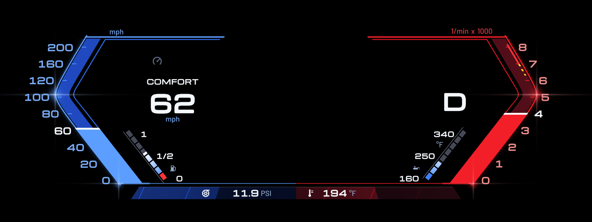
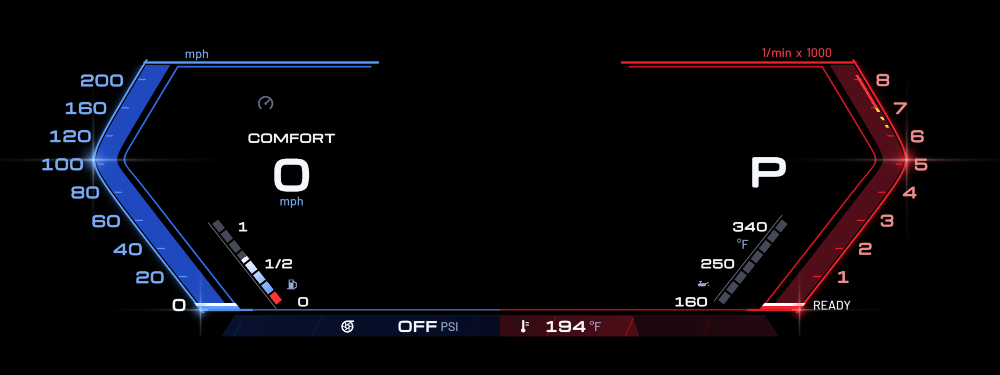
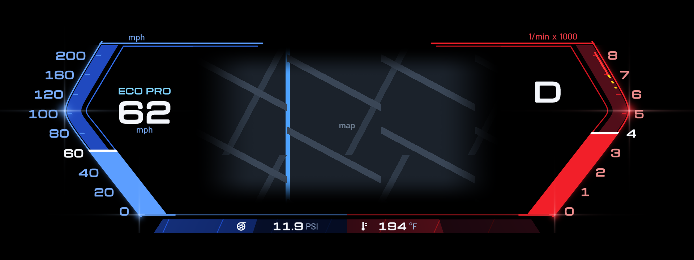
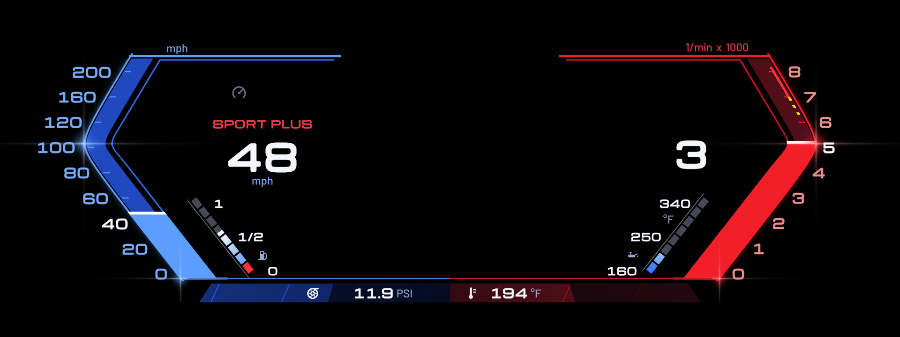

# M340i Sport layout

This is a copy of [eroobeeroo/idrive7-cluster-info](https://github.com/eroobeeroo/idrive7-cluster-info)
(at commit 10cefda) with one more layout for **Cluster Layouts**: **M340i Sport**, for a petrol
M340i (G20, B58) with iDrive 7 (MGU) and the 12.3" Live Cockpit Professional cluster.
Everything else is the original project, under its own licence and notices
(`LICENSE`, `NOTICE.md`): free, noncommercial, credits kept.

| Engine off | Waze map, ECO PRO | Manual, SPORT PLUS |
|---|---|---|
|  |  |  |

*(Drawn by `tools/preview.js` from the shaders the cluster runs. Not yet seen on a car.)*

## What the layout does

- Speed 0-200 mph and revs 0-8 (x 1000) with the red line at 7000.
- The reading fills the whole bracket, over the tick marks and out to both lines, and runs into the
  bottom line; a white bar sits across it at the reading. The numeral nearest the reading turns white.
- Gear: `D` (or `S`) alone in automatic, the gear's number alone (1-8) in manual, `P` / `R` / `N`.
- Drive mode over the speed, as the car names it: ECO PRO light blue, SPORT and SPORT PLUS red,
  COMFORT white.
- Oil temperature bar on 160 / 250 / 340 °F, fuel bar, boost and coolant in the bottom bar.
- Engine off: READY stands where the rev scale's 0 is; the 0 comes back when the engine runs.
- Waze map in the centre with its edges faded out, so the window has no visible sides.
- The car's own strip under the layout shows the range, time, outside temperature and drive mode.

## Install

1. Create a new **public** repository on GitHub and upload the contents of this folder to it
   (drag the files into "Add file > Upload files", or `git init`, `git add -A`, `git commit`, `git push`).
2. On the car, in the **MGU Store**, add your repository as a source (`yourname/yourrepo`) and install
   **Cluster Layouts** from it. Remove the original Cluster Layouts first if it is installed.
   The Store installs what the app needs (the cluster renderer, the GPU renderer, the controller gate).
3. Cluster Layouts > Settings:
   - Layout: **M340i Sport**
   - Vehicle: **Petrol or diesel**
   - Fuel tank size: **59 L**
   - leave the rest as it is (mph, Fahrenheit, red zone from 7000, the car's own bottom strip)
4. For the map: install **Waze on cluster** (0.9.107 or later, from `eroobeeroo/idrive-apps`), set the car's
   *Central display area* to *Map view*, and set *Centre of the cluster* to **Waze**.
5. Press **Show on the cluster**. Check it parked first, and switch it off if anything is hidden.

It needs the MGU Store already running on the head unit (see
[robertnisipeanu/mgu-store](https://github.com/robertnisipeanu/mgu-store)). It does not work on
iDrive 8 or 8.5 cars.

## What changed against the original

| File | Change |
|---|---|
| `apps/cluster_layouts/layout_m340.js` | new: the layout |
| `apps/cluster_layouts/layouts.js`, `app.json` | lists the layout; version 0.28.2 |
| `shared/shaders.js`, `shared/engine.js` (and each app's copy) | `SDASH_FS` `u_full` (the reading fills the bracket), a `fade` piece (soft map edges) |
| `apps/cluster_layouts/layout_sport.js` | sets `u_full` to 0: Sport draws as before |
| `tools/test_engine.js`, `tools/clearance.js` | know the new gear text and the map's soft edges |

Check after a change: `node tools/sync_shared.js` (after editing `shared/`), then
`node tools/test_engine.js && node tools/test_app.js && node tools/test_shared.js && node tools/clearance.js`.
